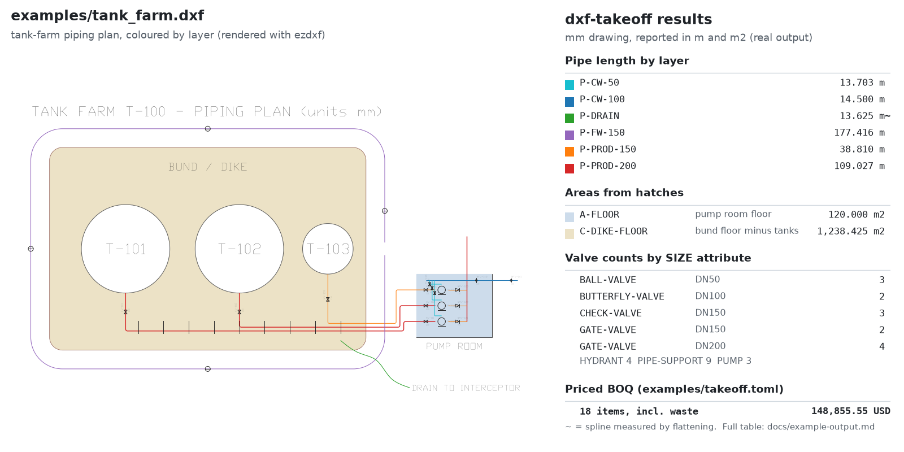

# dxf-takeoff: quantity takeoff from DXF drawings (lengths, areas, block counts) to Excel BOQ

[](https://github.com/Shahnawaz75/dxf-takeoff/actions/workflows/ci.yml)
[](LICENSE)

**dxf-takeoff** is a free, open-source Python tool for quantity takeoff from DXF drawings: it gives you the total length of lines by layer, the area of closed polylines and hatches, and can count blocks (split by attributes such as SIZE or TAG), then turns those quantities into a priced BOQ / MTO in Excel, CSV or JSON, with no AutoCAD needed.



Real output for the example drawing in [`examples/`](examples/) (areas and BOQ cut here; the full run is in [docs/example-output.md](docs/example-output.md)):

```console
$ dxf-takeoff examples/tank_farm.dxf --out-units m --group-by-attrib SIZE --rules examples/takeoff.toml
dxf-takeoff 0.1.0 | tank_farm.dxf | layout Model
Units: drawing mm ($INSUNITS=4) -> report m / m2, scale 1

LENGTHS BY LAYER
Layer        Entities  Length [m]
-----------  --------  -----------
A-PUMPROOM          1      44.000
C-DIKE-WALL         1     160.566
EQUIP-TANK          3     113.097
P-CW-50             3      13.703
P-CW-100            1      14.500
P-DRAIN             1      13.625~
P-FW-150            1     177.416
P-PROD-150          4      38.810
P-PROD-200          3     109.027
SYMBOL             54      79.458
-----------  --------  -----------
Total              72     764.204

BLOCKS
Block            SIZE  Count
---------------  ----  -----
BALL-VALVE       50        3
BUTTERFLY-VALVE  100       2
CHECK-VALVE      150       3
GATE-VALVE       150       2
GATE-VALVE       200       4
HYDRANT          -         4
PIPE-SUPPORT     -         9
PUMP             -         3
---------------  ----  -----
Total                     30
```

## Why

Estimators, piping and MEP engineers and quantity surveyors need numbers out of CAD drawings: metres of
pipe, cable, duct and wall per layer, square metres of rooms, plates and hatched areas, and how many
valves, fittings or fixtures of each size. Inside AutoCAD that usually means TLEN/AREA LISP routines,
DATAEXTRACTION (not available in every CAD program or edition) or a paid plugin. Outside AutoCAD there
was no good free tool: the open-source options are small scripts that sum line lengths, or work on PDFs.

dxf-takeoff reads the DXF file directly and is careful about the things that make quick scripts wrong:

- polyline **bulges are measured as true arcs**, not as chords;
- **block references** are expanded through any depth of nesting with the full transformation,
  including rotation, mirroring and **non-uniform scaling** (a circle in a block scaled 2 x 1 is
  measured as the ellipse it becomes), and **MINSERT** arrays count every instance;
- **dynamic blocks** (anonymous `*U` blocks) are counted under their real name;
- **hatch areas** subtract holes and islands according to the hatch style;
- **units** come from `$INSUNITS` and every table says which units it is in;
- a small **rules file** turns quantities into a priced BOQ with waste factors, and tells you which
  layers and blocks it did not price.

## Install

dxf-takeoff needs Python 3.10 or newer. Install it from GitHub, with Excel support:

```bash
pip install "dxf-takeoff[xlsx] @ git+https://github.com/Shahnawaz75/dxf-takeoff"
```

or without Excel support (terminal, CSV and JSON output only):

```bash
pip install "git+https://github.com/Shahnawaz75/dxf-takeoff"
```

A PyPI release (`pip install dxf-takeoff`) is coming soon. The only required dependency is
[ezdxf](https://github.com/mozman/ezdxf); `openpyxl` is needed for `--xlsx`.

## Quick start

```bash
dxf-takeoff plan.dxf                          # lengths, areas and block counts in drawing units
dxf-takeoff plan.dxf --out-units m            # lengths in m, areas in m2
dxf-takeoff plan.dxf --layer "P-*" --out-units m --xlsx takeoff.xlsx
dxf-takeoff plan.dxf --out-units m --rules takeoff.toml --xlsx boq.xlsx   # priced BOQ
```

To try it on the example drawing, clone the repository and run:

```bash
dxf-takeoff examples/tank_farm.dxf --out-units m --group-by-attrib SIZE --rules examples/takeoff.toml
```

Run `dxf-takeoff --help` for all options, or see the [CLI reference](docs/cli.md).

## Lengths by layer

Every linear entity contributes its length to the layer it is on: LINE, ARC, CIRCLE (circumference),
ELLIPSE (full or partial), LWPOLYLINE and 2D POLYLINE (including bulge arcs, exactly), 3D POLYLINE,
SPLINE and MLINE (reference line). Geometry inside block references is included with the block's
transformation; entities on layer `0` inside a block count on the layer of the block reference, as
AutoCAD displays them.

```bash
dxf-takeoff plan.dxf --out-units m                               # one row per layer
dxf-takeoff plan.dxf --out-units m --group-by layer+linetype     # split by linetype
dxf-takeoff plan.dxf --out-units m --group-by layer+color        # split by colour
dxf-takeoff plan.dxf --no-block-geometry                         # ignore linework inside blocks
```

Splines are measured by flattening them into short chords (default maximum deviation 1e-6 x the
spline size, or set `--spline-tolerance` in drawing units). Rows that contain splines are marked `~`
and the notes state the method.

## Areas (polylines and hatches)

The areas table lists, per layer, the enclosed area (and with `--perimeter` the perimeter) of:

- closed LWPOLYLINE and POLYLINE, with exact bulge arcs; a polyline whose last vertex returns to its
  first one counts as closed even if the "closed" flag is not set;
- CIRCLE, full ELLIPSE and closed SPLINE (approximate, as above);
- HATCH and MPOLYGON: every boundary path, polyline or edge path with lines, arcs, elliptic arcs and
  splines; holes and islands follow the hatch style (normal, outer or ignore).

Areas inside blocks are scaled by the block scale (x-scale times y-scale).

```bash
dxf-takeoff plan.dxf --out-units m --layer "A-FLOOR*" --perimeter
```

## Count blocks and attributes

Block references are counted by their effective name: an anonymous `*U12` block that AutoCAD created
for a dynamic block is counted under the dynamic block's name. MINSERT arrays count rows x columns.

```bash
dxf-takeoff plan.dxf --group-by-attrib SIZE           # GATE-VALVE 100: 3, GATE-VALVE 150: 2 ...
dxf-takeoff plan.dxf --group-by-attrib TAG,SIZE       # one row per tag and size
dxf-takeoff plan.dxf --nested                         # also count blocks inside other blocks
```

Without `--nested` only references placed directly in the layout are counted (a pump skid block
counts as one skid, not as its valves). With `--nested` the valves inside every skid are counted too,
multiplied by the number of skids, and a "Nested" column shows how many of them came from inside blocks.

## Price it: BOQ rules file

A `takeoff.toml` file maps layers and blocks to BOQ items with a description, unit, waste factor and
unit rate. Layer and block names accept wildcards.

```toml
[settings]
title = "Tank farm T-100"
currency = "USD"

[[item]]
code = "1.01"
description = "CS pipe DN200 SCH40, product lines"
match_layer = "P-PROD-200"
quantity = "length"        # length | area | perimeter | count
unit = "m"
waste = 5                  # percent
rate = 95.00

[[item]]
code = "2.01"
description = "Gate valve DN200 Class 150"
match_block = "GATE-VALVE"
where = { SIZE = "200" }   # attribute filter
quantity = "count"
unit = "nr"
rate = 1450.00

[[item]]
code = "3.02"
description = "Bund floor coating"
match_layer = "C-DIKE-FLOOR"
quantity = "area"
unit = "m2"
waste = 10
rate = 18.50
```

```bash
dxf-takeoff plan.dxf --out-units m --rules takeoff.toml --xlsx boq.xlsx
```

The BOQ table shows the measured quantity, waste, quantity including waste, rate and amount, with a
total. Below it, dxf-takeoff lists the layers and blocks that no item picked up, so nothing is missed
silently. The full reference is in [docs/boq-rules.md](docs/boq-rules.md) and a complete example is
[examples/takeoff.toml](examples/takeoff.toml). Rates in the example are illustrative only.

## Units and scale

dxf-takeoff reads the drawing units from the `$INSUNITS` header (mm, cm, m, inch, feet and the
other AutoCAD codes). Every table header shows the unit, e.g. `Length [m]` and `Area [m2]`.

| Option | Meaning |
| --- | --- |
| `--out-units m` | report lengths in m and areas in m2 (also `mm`, `cm`, `km`, `in`, `ft`, `yd`, `mi`) |
| `--units mm` | the drawing is in mm, whatever `$INSUNITS` says (needed for unitless drawings) |
| `--scale 50` | the drawing is not drawn full size: real size = drawing size x 50 (areas x 2500) |

If a drawing has no units (`$INSUNITS = 0`), quantities are reported in drawing units (`du`) and
converting them requires `--units`. dxf-takeoff never guesses units.

## Excel / CSV / JSON output

- `--xlsx takeoff.xlsx` writes a workbook with the sheets **Summary, Lengths, Areas, Blocks and BOQ**:
  styled headers, sensible column widths, number formats, frozen header rows and filters. Totals are
  real `=SUM()` formulas and BOQ amounts are `=quantity x rate` formulas, so you can change a rate or
  a waste factor in Excel and the totals update. Needs the `[xlsx]` extra.
- `--csv DIR` writes `lengths.csv`, `areas.csv`, `blocks.csv` and, with rules, `boq.csv` (UTF-8,
  unit in the column name, e.g. `length_m`).
- `--json FILE` writes everything (tables, totals, BOQ, notes) as JSON; `--json -` prints it to
  stdout instead of the table.

The exit code is 0 on success and 2 on any error (unreadable file, unknown unit, invalid rules), so
dxf-takeoff can run in scripts and CI.

## Python API

```python
from dxf_takeoff import takeoff

result = takeoff("plan.dxf", out_units="m")
for row in result.lengths:
    print(row.layer, round(row.length, 3), result.length_unit)

result.length("P-CW-*")                    # total length on matching layers
result.area("A-FLOOR")                     # total area on a layer
result.count("GATE-VALVE", SIZE="100")     # block references with an attribute value

priced = takeoff("plan.dxf", out_units="m", group_by_attribs=["SIZE"], rules="takeoff.toml")
print(priced.boq.total, priced.boq.currency)

from dxf_takeoff.excel import write_xlsx
write_xlsx(priced, "boq.xlsx")
```

`takeoff()` also accepts an ezdxf `Drawing`, and takes the same options as the CLI (`units`,
`scale`, `layers`, `exclude_layers`, `include_hidden`, `layout`, `group_by`, `nested`,
`block_geometry`, `spline_tolerance`). `result.to_dict()` returns the JSON structure.

## How accurate is it?

Quantities are computed from the exact geometry, not from a rendering:

- **Lines, circles, arcs and polyline bulges** use closed-form formulas, accurate to floating-point
  precision (about 1e-15 relative).
- **Ellipses and arcs in non-uniformly scaled blocks** are elliptic arcs; their length is an elliptic
  integral, computed by adaptive Gauss-Legendre quadrature to about 1e-12 relative. Tests compare it
  with the Gauss-Kummer series and Ramanujan's second approximation.
- **Areas** use Green's theorem on the exact arcs, so a polyline with bulges, a hatch with arc and
  ellipse edges, or a circle in a scaled block has an exact area. Coordinates far from the origin
  (survey coordinates) do not lose precision.
- **Splines** are the exception: they are flattened, and their rows are marked `~`. With the default
  tolerance the length error is typically below 1e-6 relative; areas bounded by splines below 1e-5.

The test suite (70+ tests) builds drawings with known answers: a 1000 x 500 rectangle, bulge
semicircles, nested blocks scaled 2x and rotated, a circle in a block scaled 2 x 1, hatches with
holes and islands, a 3 x 2 MINSERT, dynamic blocks, attribute grouping, unit conversion, frozen
layers and BOQ pricing. The example drawing's pipe lengths and areas are also computed by hand in
[examples/make_example.py](examples/make_example.py), and the tests check that both agree to 12
significant digits. CI runs the tests on Linux and Windows with Python 3.10 to 3.14.

A takeoff is still only as good as the drawing. Check the [limitations](#limitations) before pricing a job.

## Limitations

- **DXF only.** DWG files must be converted first (see the FAQ).
- **Overlapping or duplicated lines are counted twice.** Clean the drawing first (e.g. AutoCAD
  OVERKILL) if it may contain duplicates.
- **Not measured:** REGION, 3DSOLID, SURFACE, MESH, polyface/polygon meshes, SOLID, TRACE, 3DFACE,
  XLINE and RAY. They are counted and listed in the notes, never silently ignored.
- **Self-intersecting closed polylines** (figure-eight shapes) get their net, signed area.
- **MLINE** contributes the length of its reference line, not of each element.
- **External references (xrefs)** are not loaded; bind them or measure the xref file itself.
- **Paper space** is measured as drawn on the layout; viewports are not followed into model space.
- **Areas are planar:** each shape is measured in its own plane; nothing is projected onto the floor plan.
- **Wildcards** are shell-style (`*`, `?`, `[abc]`), not AutoCAD's full set (`#`, `@`, `~`).
- Dynamic blocks resolve through the `AcDbBlockRepBTag` data AutoCAD writes; anonymous blocks without
  it keep their `*U` name and are listed in the notes.

## FAQ

### How do I get the total length of lines in a DXF / AutoCAD drawing?

Save or export the drawing as DXF and run `dxf-takeoff drawing.dxf --out-units m`. The lengths table
gives the total length of all lines, polylines, arcs, circles and splines per layer, and the last row
is the grand total. Use `--layer "PIPE*"` to restrict it to some layers. Unlike a TLEN LISP routine,
it needs no AutoCAD, measures bulge arcs exactly and includes geometry inside blocks.

### How do I calculate areas from a DXF file?

Run `dxf-takeoff drawing.dxf --out-units m --perimeter`. Closed polylines, circles, ellipses and
hatches are listed per layer in m2. Hatches subtract their holes, so a floor hatch around columns
gives the net floor area. Put the areas you need on their own layer, or filter with `--layer`.

### How do I count blocks in a drawing?

Every run includes a blocks table with the number of references per block name. Add
`--group-by-attrib SIZE` (or any attribute tags) to split the counts by attribute value, for example
valves by size, and `--nested` to include blocks inside other blocks. Dynamic blocks are counted
under their real name.

### Does it work with DWG?

Not directly: dxf-takeoff reads DXF only and tells you so if you give it a DWG. Convert DWG files to
DXF first, for example with the free ODA File Converter from the Open Design Alliance, or with
"Save As DXF" in any CAD program. The conversion keeps the geometry, so the quantities are the same.

### Does it work with AutoCAD LT drawings?

Yes. AutoCAD LT (like full AutoCAD, BricsCAD, DraftSight, LibreCAD, QCAD and most other CAD programs)
can save drawings as DXF, and dxf-takeoff reads those files like any other DXF. It does not need
AutoCAD or LISP at all.

### Can I use it on many drawings at once?

Yes. It is a normal command-line program, so a shell loop works, and the Python API returns plain
data you can combine:
`for f in *.dxf; do dxf-takeoff "$f" --out-units m --csv "out/${f%.dxf}"; done`.

## See also

- [dxf-diff](https://github.com/Shahnawaz75/dxf-diff): compare two DXF revisions and see what changed.
- [ezdxf](https://github.com/mozman/ezdxf): the Python DXF library dxf-takeoff is built on.

## Contributing

Bug reports with a small DXF file that shows the problem are the most useful contribution. See
[CONTRIBUTING.md](CONTRIBUTING.md) for the development setup and the testing rules (every quantity
needs a test with a known answer).

## License

MIT, see [LICENSE](LICENSE).

If dxf-takeoff saved you time on a takeoff, a star on GitHub helps other estimators find it.
