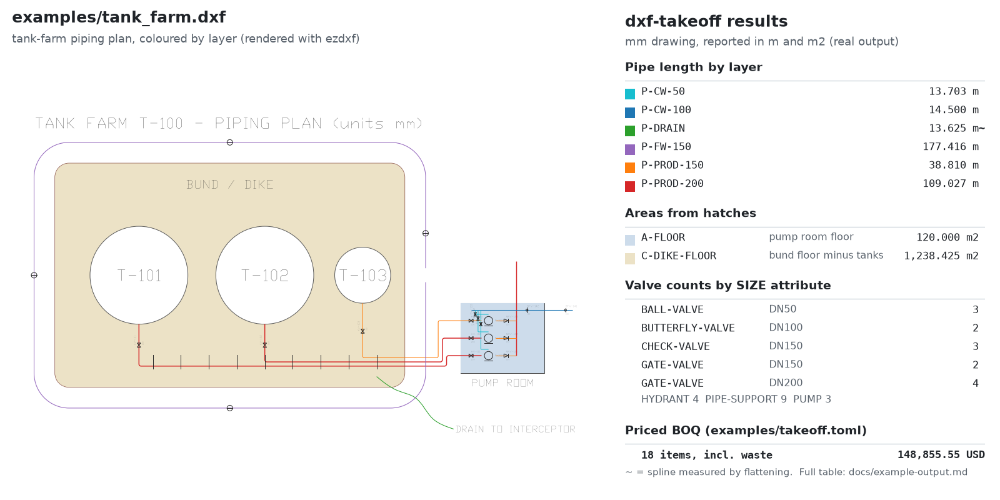

# dxf-takeoff

**Quantity takeoff from DXF drawings: lengths, areas and block counts, priced into an Excel BOQ.**

dxf-takeoff is a free, open-source Python command-line tool and library. Give it a DXF file and it
reports the total length of lines by layer, the area of closed polylines and hatches, and the number
of block references (valves, fittings, fixtures, nozzles), optionally split by attribute values such
as SIZE or TAG. A small rules file turns those quantities into a priced bill of quantities (BOQ) or
material takeoff (MTO) in Excel, CSV or JSON. No AutoCAD is needed.



## Install

```bash
pip install "dxf-takeoff[xlsx] @ git+https://github.com/Shahnawaz75/dxf-takeoff"
```

Python 3.10 or newer. A PyPI release is coming soon.

## Use

```bash
dxf-takeoff plan.dxf --out-units m                                   # lengths, areas, blocks
dxf-takeoff plan.dxf --out-units m --group-by-attrib SIZE            # valves by size
dxf-takeoff plan.dxf --out-units m --rules takeoff.toml --xlsx boq.xlsx   # priced BOQ in Excel
```

```python
from dxf_takeoff import takeoff

result = takeoff("plan.dxf", out_units="m")
print(result.length("P-CW-*"), result.area("A-FLOOR"), result.count("GATE-VALVE", SIZE="100"))
```

## What it measures

- **Lengths by layer** (or layer + linetype / colour): lines, arcs, circles, ellipses, polylines with
  exact bulge arcs, 3D polylines, splines and multilines, including the geometry inside blocks.
- **Areas**: closed polylines, circles, ellipses, closed splines, and hatches with their holes and islands.
- **Block counts** by effective name (dynamic blocks resolved), split by attributes, with MINSERT
  arrays and optional nested counts.
- **Units**: `$INSUNITS` is read, can be overridden, converted to any output unit, and a scale
  factor handles drawings that are not drawn full size.

Block references are expanded with their full transformation, so a circle in a block scaled 2 x 1 is
measured as the ellipse it becomes, and areas in scaled blocks scale with x-scale times y-scale.

## Documentation

- [Example output](example-output.md): the real terminal output for the tank-farm example.
- [BOQ rules file reference](boq-rules.md): pricing layers and blocks with `takeoff.toml`.
- [Command line reference](cli.md): every option, and its Python equivalent.
- [README on GitHub](https://github.com/Shahnawaz75/dxf-takeoff#readme): accuracy, limitations and FAQ.

## Accuracy in one paragraph

Lengths and areas are computed from the exact geometry with closed-form formulas (lines, arcs,
bulges, circles) or adaptive quadrature accurate to about 1e-12 (elliptic arcs). Only splines are
approximated, by flattening with a stated tolerance, and their rows are marked `~`. The test suite
checks every entity type against known answers, and the example drawing against a hand calculation.
Overlapping duplicate lines are counted twice, so clean drawings before pricing.

Source code, issues and releases: [github.com/Shahnawaz75/dxf-takeoff](https://github.com/Shahnawaz75/dxf-takeoff).
